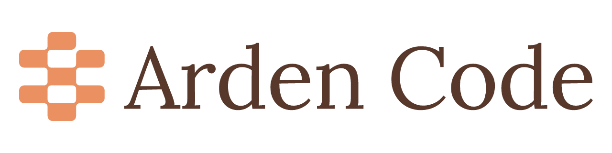

<h1 align="center">
  <picture>
    <source media="(prefers-color-scheme: dark)" srcset="brand/assets/github/readme-header-dark.png">
    
  </picture>
</h1>

A desktop cockpit for Claude Code and Codex.

> **Status: pre-alpha, work in progress.** There is nothing to install yet.

## What it will be

Arden Code is a desktop app for Windows 11 and Linux for running and supervising
coding agents from one place. The goals:

- **Keyboard-first:** a command palette, rebindable shortcuts, and full keyboard navigation.
- **Private:** no telemetry. The only automatic network request is the update check.
- **Hands off your credentials:** Claude Code and Codex sign in through their own CLIs.
  Arden Code never reads, stores or forwards your tokens.
- **Native to its platform:** Snap Layouts, regional formats, text scaling and keyboard conventions on
  Windows 11; the desktop's frame, locale and text size on Linux.

The first build is the app foundation: the window shell, settings, keyboard system,
diagnostics, and a placeholder session view driven by a built-in Demo agent.
Real Claude Code and Codex integration comes after that. See [the plan](docs/PLAN.md).

## Tech

Tauri 2 (Rust) · React 19 · TypeScript 7 · TanStack Router and Query · shadcn/ui (Radix) · Tailwind CSS 4

## Requirements (planned)

- Windows 11, x64, or Linux x64 (any current desktop, Wayland or X11; `.deb`, `.rpm` or AppImage)
- The Claude Code and/or Codex CLI, installed and signed in

## Development

Setup, build and test instructions are in [docs/dev-setup.md](docs/dev-setup.md). See also [CONTRIBUTING.md](CONTRIBUTING.md), [SECURITY.md](SECURITY.md) and [PRIVACY.md](PRIVACY.md).

Design decisions are recorded in [docs/adr](docs/adr/README.md).

## License

[MIT](LICENSE) © 2026 Dimitris Valasellis. Bundled fonts keep their own licenses (SIL Open Font License 1.1).

Arden Code is an independent project. It is not affiliated with, endorsed by, or sponsored by
Anthropic or OpenAI. Claude, Claude Code, Codex and OpenAI are trademarks of their respective owners.
